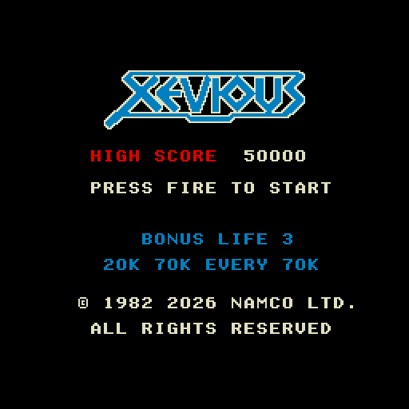
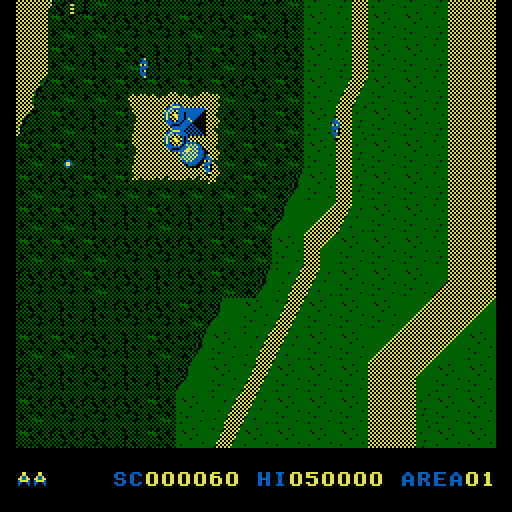
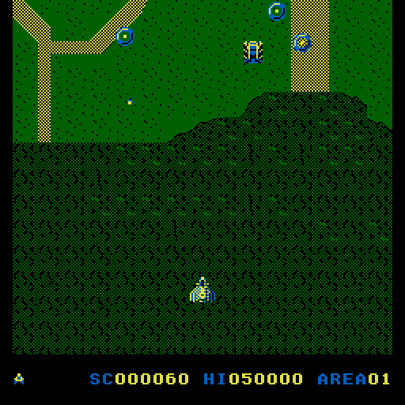

# Xevious — порт на Вектор-06Ц (v0.1b)

**Xevious** в версии для **Amstrad CPC 6128** (Easter Egg, 2026; авторы — Nemo: код и звуки, TotO: графика;
проигрыватель — Arkos Tracker, Targhan; упаковщик ZX0 — Einar Saukas) на ванильном **Векторе-06Ц**: i8080 3 МГц,
64 КБ, без Z80-переходника и квазидиска. Оригинальная игра — Namco, 1982.

Логика CPC разобрана в SkoolKit (`src/cpc/*.ctl`), описана JS-моделью (`src/model/`) и переведена на i8080
(`src/i80/`). Перевод сверен с Z80 оригинала: каждая процедура на одном и том же снимке (`tools/cpc/oracle.js --i80`,
8 зон × 3 режима), и весь образ Вектора — обновление в обновление рядом с моделью CPC (`tools/vec/lockvec.js`).

Это ранняя версия: игра проходится, но темп пока ниже, чем у CPC (≈2,1 кадра на обновление против 2,03),
и спрайты мерцают.

 



## Сборка

В репозиторий не входят материалы оригинала: ни образ диска, ни графика, ни музыка. Всё это снимается при сборке
с вашего диска CPC.

- Нужны Node.js и Python 3 с Pillow.
- Диск: `Xevious (UK) (128K) (2026) [Original].dsk` (CRC C42C49A7, [CPC-Power, fiche 20000](https://www.cpc-power.com/index.php?page=detail&num=20000))
  положите в `ref/cpc/`.

```sh
node tools/vecbuild.js     # rom/Xevious-v06c.rom (загрузка с 0100h) и несжатый build/xevious.rom для стендов
```

Своя заставка (необязательно): картинку положите в `ref/splash/xevious_splash.png` — `tools/vecsplash.py` сведёт её
к 256×256 и 16 цветам. Без неё при старте показывается загрузочный экран CPC.

Тоже необязательно: логотип титула — `ref/title/logo.png` (без него берётся логотип CPC); музыка заставки —
модуль PT3 `ref/music/splash.pt3` и его покадровый дамп AY `ref/music/splash.ay14` (+ `.ay14.pos`), см.
`tools/vecmusic.js`; без них заставка без музыки.

Образ открывается в Emu80 (платформа «Вектор-06Ц») и vector06js как `.rom`.

## Управление

| действие | клавиатура | джойстик «П» |
|---|---|---|
| движение | ← → ↑ ↓ | влево, вправо, вверх, вниз |
| выстрел (воздух) | пробел | огонь |
| бомба (земля) | M | вторая кнопка |
| пауза | ВК | |
| звук вкл/выкл | S | |
| выход на титул | АР2 в паузе | |

Старт — огонь на титуле. F1 + F3 на титуле — старт с читами (бесконечные жизни); в такой игре G включает
и выключает неуязвимость.

## Что сделано для Вектора

- **Экран.** Две плоскости, аппаратная вертикальная прокрутка. Поле 224 строки, под ним полоса 32 строки с панелью.
- **Панель** в одну строку: запасные корабли (двухцветные), очки `SC`, рекорд `HI`, зона `AREA`.
  При прокрутке она переносится из видеопамяти, а не рисуется заново.
- **Спрайты** выводятся с сохранением фона. Неподвижная наземная цель не перерисовывается; корабль и прицел,
  если их ничего не задевает, стираются прямо перед новым выводом — мерцают вдвое меньше.
- **Звук на ВИ53.** Музыка и эффекты Arkos Tracker переложены на три канала: фон, заставка жизни, конец игры,
  эффекты.
- **Старт.** Игра в образе сжата (`tools/vecboot.js`). Пока она не распакована, весь экран свободен под
  заставку с музыкой (AY, если есть, иначе ВИ53 и бипер), которая стоит до нажатия клавиши. Потом игра
  распаковывается на месте, это меньше секунды.
- **Титул** своим шрифтом: логотип, рекорд, «PRESS FIRE TO START». Таблицы рекордов и ввода имени нет.

## Устройство и проверки

- [docs/PORT_PLAN.md](docs/PORT_PLAN.md) — решения по переносу;
- [docs/PLATFORM.md](docs/PLATFORM.md) — платформа Вектора;
- [docs/I8080.md](docs/I8080.md) — правила перевода на i8080;
- [docs/SOUND.md](docs/SOUND.md) — звук;
- [docs/JOURNAL.md](docs/JOURNAL.md) — журнал работы.

Стенды:
- `tools/cpc/oracle.js` — процедуры против Z80;
- `tools/vec/lockvec.js` — образ против CPC, темп, экран;
- `tools/vec/hangcheck.js` — долгая игра с гибелью;
- `tools/vec/flicker.js` — мерцание по лучу.

Лицензия — см. [LICENSE](LICENSE) и [NOTICE](NOTICE).
